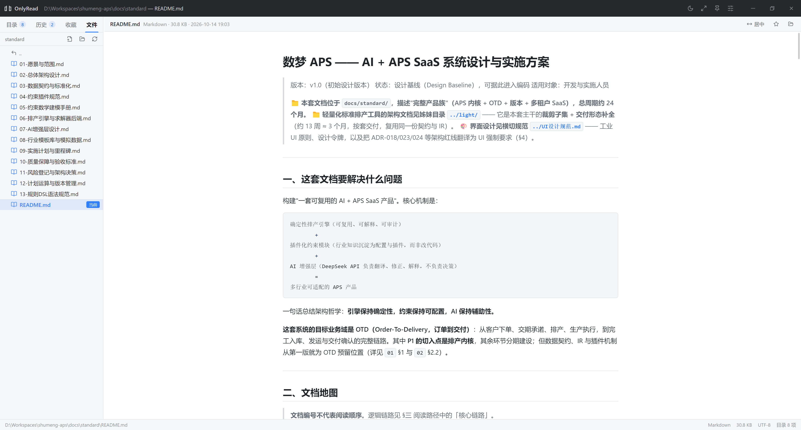

<div align="center">


# OnlyRead

**跨平台的本地文件阅读器 —— 打开一个文件，或直接打开一整个文件夹**


</div>

---

## 目录

- [OnlyRead](#onlyread)
  - [目录](#目录)
  - [简介](#简介)
  - [界面预览](#界面预览)
  - [特性](#特性)
  - [支持的文件类型](#支持的文件类型)
  - [快捷键](#快捷键)
  - [安装](#安装)
  - [开发](#开发)
  - [打包与分发](#打包与分发)
  - [技术栈](#技术栈)
  - [项目结构](#项目结构)
  - [实现说明](#实现说明)
  - [已知限制](#已知限制)
  - [贡献](#贡献)
  - [关于作者](#关于作者)
  - [许可证](#许可证)

---

## 简介

OnlyRead 是一款面向开发者与文档工作者的桌面阅读器。和「一次只打开一个文件」的常规阅读器不同，
它把**整个文件夹当作一座书库**：左侧是文件树与索引，右侧是内容预览，不必在多个工具之间来回切换，
也不需要把文件导入任何资料库或转换格式。

所有读取都在本地完成——不联网、不上传、不建立后台索引。

- **什么都能读**：纯文本 / 代码、Markdown、网页、PDF、Word、PowerPoint、图片
- **就地读取**：直接读磁盘上的原文件，不复制、不改写、不移动
- **两端一致**：Windows / macOS / Linux 上的功能完全相同

## 界面预览

<div align="center">



</div>

打开一个文件夹后：左侧是 `目录 / 历史 / 收藏 / 文件` 标签页与文件树，
右侧是内容预览（当前为 Markdown，含文档大纲跳转），底部状态栏显示路径、类型、大小、编码与大纲条目数。

## 特性

- **左右分栏**：左栏为 `目录 / 历史 / 收藏 / 文件` 四个标签页，分隔条可拖拽调整宽度
- **多种打开方式**：系统对话框、拖拽文件到窗口、命令行参数、系统「打开方式」
- **文件树**：目录懒加载、隐藏文件开关、收藏、在文件管理器中显示
- **文档大纲**：从 Markdown / HTML / Word 标题、PDF 书签、PPT 幻灯片自动提取，点击跳转并跟随滚动高亮
- **排版宽度**：预览区可在 `居中 / 宽屏 / 全宽` 三档之间切换（作用于文档型内容，设置本地持久化）
- **阅读体验**：浅色 / 深色 / 跟随系统主题、窗口置顶、全屏、阅读历史与收藏（本地持久化）
- **编码自适应**：自动识别 UTF-8 / UTF-8 BOM / UTF-16 LE / UTF-16 BE / GB18030 / Big5，兼容中文旧文件
- **大文件**：PDF 通过自定义协议流式读取，数百 MB 的文档也能快速打开（实现见下文）
- **状态栏**：显示路径、类型、大小、编码、页数 / 幻灯片数、大纲条目数

## 支持的文件类型

| 类型 | 扩展名 | 渲染方式 |
| --- | --- | --- |
| 纯文本 / 代码 | `.txt` `.log` `.csv` `.json` `.xml` `.yml` `.ini` `.sql` `.js` `.ts` `.py` `.go` `.rs` `.java` `.c` `.cpp` `.css` `.vue` … | 等宽字体 |
| Markdown | `.md` `.markdown` `.mdx` `.mdown` `.mkd` | GFM（表格、任务列表、删除线）+ 代码高亮 |
| 网页 | `.html` `.htm` `.xhtml` | 沙箱 iframe，剥离页面脚本 |
| PDF | `.pdf` | pdf.js 渲染，支持缩放与页码跳转 |
| Word | `.docx` `.docm` | mammoth 转换为 HTML |
| PowerPoint | `.pptx` `.pptm` | 内置 OOXML 解析，按幻灯片还原文本 / 图片 / 表格 |
| 图片 | `.png` `.jpg` `.jpeg` `.gif` `.webp` `.bmp` `.svg` `.avif` `.ico` | 自适应缩放 |

其他扩展名会标记为「不支持」，但仍会出现在列表中（可在设置中关闭该行为）。

## 快捷键

| 快捷键 | 功能 |
| --- | --- |
| `Ctrl/Cmd + O` | 打开文件 |
| `Ctrl/Cmd + Shift + O` | 打开文件夹 |
| `F11` | 切换全屏 |
| `Esc` | 关闭已打开的面板 |

## 安装

> **当前尚未发布预编译安装包**（v0.1.0 仍在开发中）。请按下方「开发」一节从源码构建，
> 或关注 [Releases](https://github.com/sheldon5forever/OnlyRead/releases) 页面。

从源码构建需要以下环境：

| 用途 | 要求 |
| --- | --- |
| 开发与构建 | Node.js ≥ 18（推荐 20 LTS 及以上）、pnpm ≥ 10 |
| 打包 Windows 安装包 | Windows |
| 打包 macOS 安装包 | macOS（DMG 依赖系统专有工具，无法交叉构建） |
| 重新生成品牌图标（可选） | Python 3.8+ |

## 开发

```bash
git clone https://github.com/sheldon5forever/OnlyRead.git
cd OnlyRead
pnpm install
pnpm dev
```

| 命令 | 说明 |
| --- | --- |
| `pnpm dev` | 启动开发模式（Vite HMR + Electron） |
| `pnpm typecheck` | 主进程与渲染进程的类型检查 |
| `pnpm build` | 构建产物到 `out/` |
| `pnpm start` | 以构建产物启动，用于验证生产行为 |
| `pnpm build:unpack` | 生成未压缩的应用目录，便于调试 |

`pnpm dev` / `pnpm build` 会自动执行 `scripts/prepare-assets.mjs`，把 pdf.js 的
`cmaps` 与 `standard_fonts` 复制到 `src/renderer/public/`。**缺少这些资源时，
使用 CID 字体的中文 PDF 将无法正确显示文字。**

## 打包与分发

```bash
pnpm build:win    # Windows：NSIS 安装包（x64）
pnpm build:mac    # macOS：DMG（x64 + arm64）
pnpm build:linux  # Linux：AppImage + deb
```

产物输出到 `release/`。**electron-builder 不支持跨平台出包**，各平台必须在对应系统上构建：
在 Windows 上执行 `build:mac` 会直接报错 `Build for macOS is supported only on macOS`。

首次打包时 electron-builder 会联网从 GitHub 下载 Electron 二进制。网络受限时可设置镜像：

```bash
export ELECTRON_MIRROR=https://npmmirror.com/mirrors/electron/
```

**关于签名**：仓库未配置代码签名证书，产出的安装包均未签名、未公证。
macOS 上首次打开需右键 →「打开」，否则会被 Gatekeeper 拦截；
Windows 上可能出现 SmartScreen 提示。若要正式对外分发，需自行配置
Apple Developer 证书（`CSC_LINK` / `CSC_KEY_PASSWORD` + notarize）或 Windows 代码签名证书。
未签名时建议设置 `CSC_IDENTITY_AUTO_DISCOVERY=false`，避免 electron-builder 去本机钥匙串中查找证书。

应用图标已随仓库提供（`build/icon.ico`、`build/icon.icns`、`build/icon.png`），
源自 `brand/` 下的图标资产；需要重新生成时执行：

```bash
python scripts/make_icon.py   # 重新渲染各尺寸 PNG 到 brand/
python scripts/make-icon.py   # 装箱到 build/（png + ico + icns）
```

## 技术栈

- **运行时**：Electron 33
- **界面**：React 18 + TypeScript 5
- **构建**：electron-vite（主进程 / 预加载 / 渲染进程三端统一构建）+ Vite 5
- **解析**：`pdfjs-dist`、`mammoth`、`jszip` + `fast-xml-parser`、
  `react-markdown` + `remark-gfm` + `rehype-highlight`、`highlight.js`
- **打包**：electron-builder
- **图标**：`lucide-react`

## 项目结构

```
src/
├── main/                 # 主进程
│   ├── index.ts          # 窗口、IPC 路由、单实例与命令行参数处理
│   ├── fs-service.ts     # 目录列举、文本编码探测、文件读取
│   └── stream-protocol.ts# 自定义协议 orfile://（大文件流式读取）
├── preload/index.ts      # contextBridge 暴露 window.reader
├── shared/               # 主进程与渲染进程共享的类型与工具
│   ├── types.ts
│   ├── api.ts
│   ├── kind.ts           # 扩展名 → 文件类别
│   ├── limits.ts         # 各格式的体积上限
│   └── protocol.ts       # 协议名与 URL 构造
└── renderer/
    ├── index.html
    └── src/
        ├── App.tsx
        ├── components/   # 标题栏、侧栏、文件树、状态栏、欢迎页…
        ├── viewers/      # 各格式预览组件 + Viewer 调度器
        ├── lib/          # 主题、大纲提取、路径、HTML/PPTX 解析…
        └── styles/       # 设计变量与布局样式
scripts/
├── prepare-assets.mjs    # 复制 pdf.js cMap / 标准字体到渲染层
├── make_icon.py          # 生成各尺寸 PNG 图标到 brand/（零依赖）
└── make-icon.py          # 把 brand/ 的图标装箱到 build/（png + ico + icns）
brand/                    # 品牌资产：应用图标、favicon、菜单栏模板图、标记草案
build/                    # 打包资源：应用图标与 macOS entitlements
```

## 实现说明

以下几点是这个项目里不太直观、但值得说明的设计取舍：

- **安全模型**：渲染进程开启 `contextIsolation`、关闭 `nodeIntegration`，仅通过 preload 暴露的
  `window.reader` 访问文件系统；打包产物注入严格 CSP（禁止内联脚本）。
- **大文件读取**：主进程注册了私有协议 `orfile://`（支持 Range 请求与 CORS），
  PDF 由 pdf.js 直接按 URL 读取，**不再把整份文件经 IPC 传给渲染进程**，省掉一次完整的二进制拷贝。
  以 234 MB / 2000 页的 PDF 实测：打开约 1 秒，渲染进程常驻内存增加约 340 MB。
  该协议不可用时会自动回退为整份读取，功能不受影响。
- **PDF Worker**：页面在 `file://` 下无法直接以文件 URL 构造 Worker，
  因此把打包后的 worker 源码转成 Blob URL 再交给 pdf.js，保证开发与打包后行为一致。
- **PDF 目录**：优先使用文档自带书签；没有书签且页数不超过 200 时退化为页码列表，
  页数更多则不展示目录（可用工具条的页码输入框跳转）。
- **HTML 预览**：会移除页面脚本，子资源按 `<base href="file://…">` 解析。
  开发模式下渲染进程运行在 `http://localhost`，浏览器会拦截 `file://` 子资源；
  打包后（`file://` 同源）一切正常。

## 已知限制

- **格式**：仅支持 `.docx` / `.pptx`，不支持老旧的 `.doc` / `.ppt`。
  PPT 预览还原文本、图片与表格，不含复杂动画、SmartArt 与主题母版背景。
- **体积上限**：文本 8 MB；Word / PowerPoint / 图片 200 MB（需整份载入内存解析）；
  PDF 2 GB（走流式协议），回退路径 512 MB。超出上限会给出明确提示。
- **未签名产物**：见「打包与分发」一节。
- **接口稳定性**：项目处于早期阶段（v0.1.0），界面与内部 API 仍可能变动。

## 贡献

欢迎提交 Issue 与 Pull Request。

- 提交前请确保 `pnpm typecheck` 通过
- 请勿提交 `node_modules/`、`out/`、`release/` 等产物或缓存目录（`.gitignore` 已覆盖）
- 保持与现有代码一致的风格：中文注释、不做无关的格式化改动
- 新增文件格式支持时，请同步更新 `src/shared/kind.ts`、`src/shared/limits.ts` 与本文件中的格式表

## 关于作者

本项目由 **数梦 APS** 开发并维护，欢迎登录[企业官网](https://shumengkongjian.com)。

我们做的事情，是把复杂的业务需求落成真能跑起来的软件：既包括本仓库这样的跨平台桌面工具，
也包括面向企业的 SaaS 系统（AI + APS 排产，含规则引擎、数据契约与 AI 增强层）。

| 方向 | 说明 |
| --- | --- |
| 桌面应用 | Electron + React + TypeScript 跨平台客户端，关注本地文件处理与大文件性能 |
| 全栈 / SaaS | 前端、Node.js 服务端与多租户 SaaS 系统的设计与落地 |
| AI 集成 | 把大模型能力嵌进既有业务流程，而不是另外加一个聊天框 |

**目前可承接软件开发合作**（项目外包、远程协作、技术顾问均可）。有需要欢迎直接联系：

<div align="center">


**微信：数梦APS** ｜ [GitHub](https://github.com/sheldon5forever)

</div>

如果这个项目对你有帮助，欢迎点一个 Star，也方便更多人看到。

## 许可证

本项目基于 [MIT 许可证](LICENSE) 发布，版权归 **数梦 APS** 所有。
